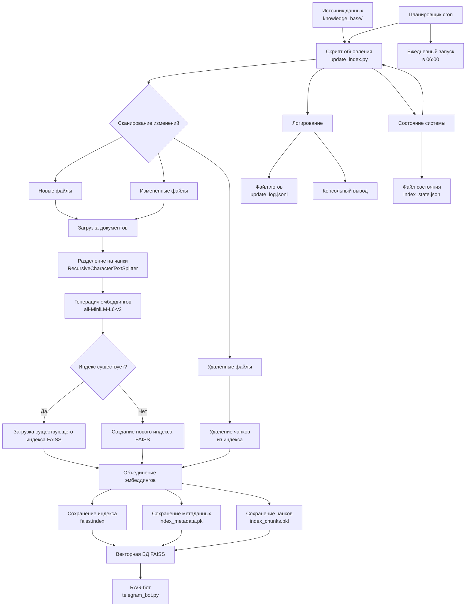

# Архитектурная диаграмма системы автоматического обновления базы знаний

## Диаграмма в формате Mermaid

## Ключевые компоненты

1. **Источник данных**: `knowledge_base/` (документы .md/.txt)
2. **Скрипт обновления**: `update_index.py` (сканирование, обработка, обновление)
3. **Процесс обработки**: чанки → эмбеддинги → FAISS индекс
4. **Логирование**: `update_log.jsonl` + консольный вывод
5. **Планировщик**: cron/Task Scheduler (ежедневно в 06:00)
6. **Состояние системы**: `index_state.json` (хеши файлов)

Диаграмма показывает полный поток данных от источника до обновлённого индекса, используемого RAG-ботом.