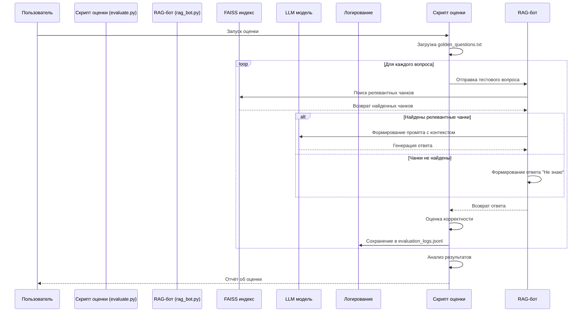
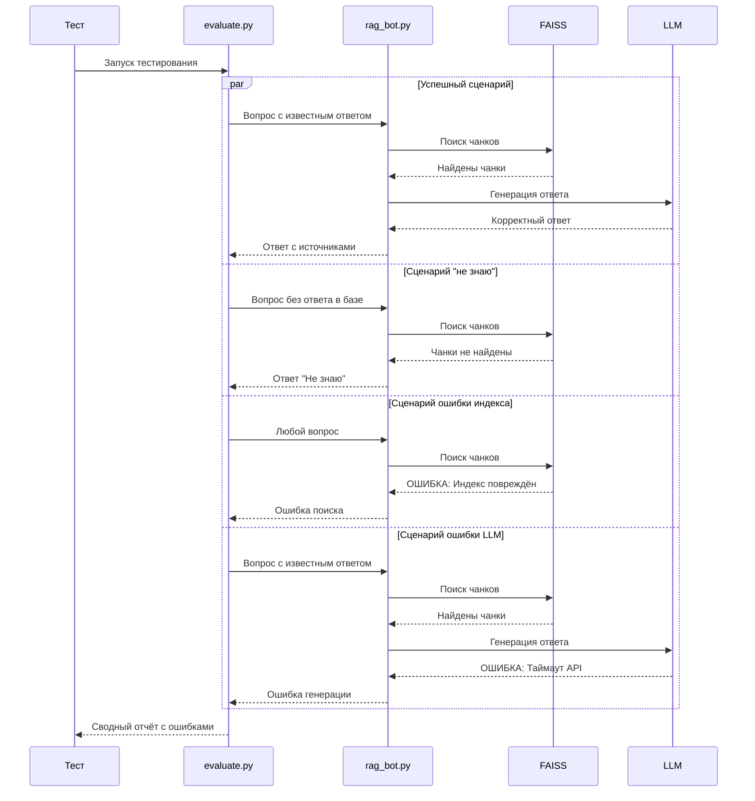

# Диаграмма последовательности оценки качества RAG-пайплайна

## Диаграмма последовательности в формате Mermaid

## Диаграмма сценариев ошибок

## Ключевые компоненты

1. **Скрипт оценки**: `evaluate.py` (автоматическое тестирование)
2. **Золотой набор**: `golden_questions.txt` (19 вопросов)
3. **RAG-бот**: `rag_bot.py` (обработка запросов)
4. **FAISS индекс**: поиск релевантных чанков
5. **LLM модель**: генерация ответов
6. **Логирование**: `evaluation_logs.jsonl` (результаты тестирования)

Диаграмма показывает процесс оценки качества, включая нормальные сценарии и обработку ошибок (пустой индекс, невалидный чанк, ошибки генерации).